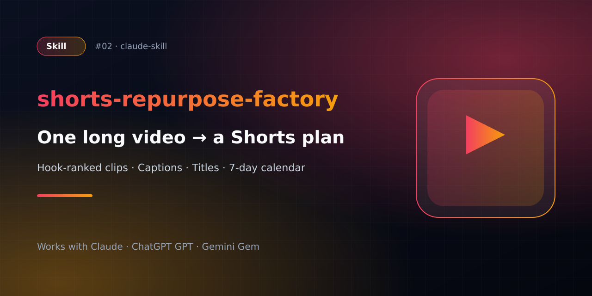

<p align="center"><a href="https://cloudskillhub.com"></a></p>

# shorts-repurpose-factory

🌐 **Website:** [cloudskillhub.com](https://cloudskillhub.com) · 📦 **All skills:** [skillhub](https://github.com/jahirulofficial0/skillhub)

Turn one long video or transcript into a hook-ranked Shorts plan — which clips to cut, opening lines, captions, titles, and a 7-day posting calendar.

**Works with:** Claude (Code, Desktop, claude.ai) · ChatGPT custom GPT · Gemini Gem

## Install

### Claude Code — this skill only
```
/plugin marketplace add jahirulofficial0/skillhub
/plugin install shorts-repurpose-factory@skillhub
```
Or directly from this repo: copy `skills/shorts-repurpose-factory/` into `~/.claude/skills/`.

### All 10 skills at once
See **[skillhub](https://github.com/jahirulofficial0/skillhub)** — one marketplace, or one MCP server that serves all 10 skills.

### claude.ai
Download `skills/shorts-repurpose-factory/` as a ZIP → **Settings → Capabilities → Skills → Upload skill**.

### ChatGPT / Gemini
- ChatGPT GPT: [`prompts/chatgpt-gpt.md`](prompts/chatgpt-gpt.md)
- Gemini Gem: [`prompts/gemini-gem.md`](prompts/gemini-gem.md)

## Usage
Just describe the task — the skill activates when relevant. Example:

> Transcript (podcast, 42 min, niche: small business finance). [03:10] Most owners don't know their real profit... [11:45] I lost $40k because I never separated accounts... [27:30] Three numbers I check every Monday...

See [`examples/`](examples/) for a full input → output sample.

## What you get
```
## Clip Ranking
| Rank | Start–End | Score /40 | Topic | Why it works |

## Clip Packs
### Clip 1 — <working title>
- Cut: 00:00–00:00 (or start/end quote)
- Hook A / Hook B:
- On-screen caption:
- Title:
- Description + hashtags:
- Edit notes (zoom, B-roll, captions style):

## 7-Day Posting Calendar
| Day | Clip | Platform | Time slot | Title |
```

## Repository layout
```
.claude-plugin/plugin.json   Claude Code plugin manifest
skills/shorts-repurpose-factory/SKILL.md       The skill
prompts/                     ChatGPT GPT and Gemini Gem versions
examples/                    Sample input and output
assets/banner.png            Social preview image
```

## Author
**Jahirul** — [cloudskillhub.com](https://cloudskillhub.com) · [github.com/jahirulofficial0](https://github.com/jahirulofficial0)

## License
MIT — see [LICENSE](LICENSE).
